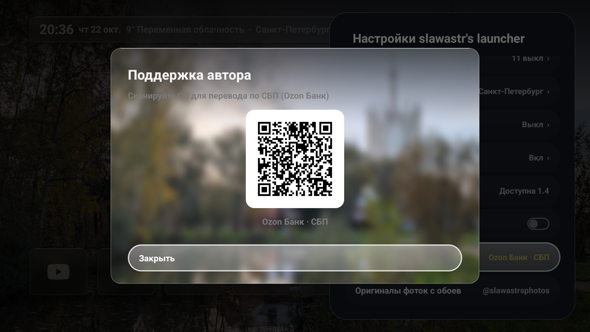

<h1 align="center">slawastr's launcher</h1>

<p align="center">
  <em>Элегантный, стеклянный и сверхбыстрый рабочий стол для Android TV и Google TV.</em>
</p>

<p align="center">
  
  
  
  
  <a href="LICENSE"></a>
</p>

---

<p align="center">
  
</p>

## 📸 Скриншоты версии 1.1

<p align="center">
  
  
  
</p>

---

## ✨ Особенности и кастомизации slawastr's launcher

- **Версия:** 1.1 | **Автор:** `slawastr`
- **Плавающее стеклянное меню настроек (Glass Floating Card):**  
  Полностью переработанная боковая карточка 400dp с закруглениями 28dp, эффектом матового стекла и 24dp интерактивными кнопками-пилюлями.
- **Встроенные QR-коды прямо в интерфейсе:**
  - 💳 **Поддержка автора:** Быстрый перевод по СБП (Ozon Банк) при сканировании камерой телефона.
  - 📷 **Оригиналы фоток с обоев:** Прямой переход в официальный Telegram-канал автора [**@slawastrsphotos**](https://t.me/slawastrsphotos) с фотографиями в исходном разрешении.
- **Готовые настройки «из коробки» (Default Presets):**
  - Тема: Тёмное стекло (*Dark Glass*) с 15% размытием подложки.
  - Типографика: Четкий жирный шрифт с левым выравниванием виджета времени и погоды.
  - Строка приложений: Подписи при наведении фокуса, высококонтрастные монохромные и цветные иконки.
  - Погода: Санкт-Петербург, градусы Цельсия.
  - Обои: Оптимальное кадрирование (-20% по вертикали) с мягким верхним градиентным затемнением.
- **Дополнительные брендовые иконки:**  
  Встроенная поддержка Кинопоиска, Rutube, V2Ray/v2rayNG, а также физических HDMI-входов (PlayStation, Xbox).
- **Экстремальная легковесность:**  
  Размер APK всего 1.3 МБ, оперативная память ~50–65 МБ, время запуска приложений 95 мс. Полное отсутствие рекламы, телеметрии и сторонних фреймворков.

---

## 📥 Установка на телевизор

1. Скачайте свежий `slawastr_launcher.apk` со страницы [**Releases**](https://github.com/SLAWASTR/slawastr-launcher/releases).
2. Установите через ADB:
   ```bash
   adb connect <IP_ТЕЛЕВИЗОРА>:5555
   adb install -r slawastr_launcher.apk
   ```
3. Зафиксируйте **slawastr's launcher** в качестве единственного главного экрана и отключите рекламу Google TV:
   ```bash
   adb shell cmd role add-role-holder --user 0 android.app.role.HOME dev.plume
   adb shell pm disable-user --user 0 com.google.android.apps.tv.launcherx
   adb shell pm disable-user --user 0 com.google.android.tungsten.setupwraith
   ```

---

## 🧹 Очистка телевизора от системного мусора (Debloat)

Телевизоры TCL и устройства на Google TV нагружены десятками фоновых сервисов сбора телеметрии, рекламы и тяжелых процессов.

> [!TIP]
> **Лучше и безопаснее всего проводить деблоатинг через ИИ-ассистента в режиме парного программирования!**  
> ИИ анализирует реальный список пакетов вашей конкретной ревизии прошивки, проверяет скрытые зависимости (например, чтобы случайно не сломать HDMI-CEC или пульт ДУ) и использует безопасный флаг `disable-user`, который позволяет вернуть любой процесс обратно без сброса настроек.
>
> 📖 Подробное пошаговое руководство с полным списком безопасных пакетов: [**docs/DEBLOAT_GUIDE.md**](docs/DEBLOAT_GUIDE.md).

---

## 🚀 Инструкция: Как собирать и заливать обновления на GitHub

### 1. Сборка APK из исходников
```bash
# Чистая сборка APK в режиме Release/Debug
./gradlew clean assembleDebug
```
Готовый файл появится по пути: `app/build/outputs/apk/debug/app-debug.apk`.

### 2. Фиксация изменений в Git и отправка в репозиторий
```bash
# Проверяем измененные файлы
git status

# Добавляем все изменения
git add .

# Делаем коммит
git commit -m "Релиз v1.1: кнопки поддержки автора (Ozon) и канал обоев (@slawastrsphotos)"

# Отправляем изменения в ветку main
git push origin main
```

### 3. Создание релиза с прикреплением APK через GitHub API / CLI
```bash
# Создание тега и отправка на GitHub
git tag -a v1.1.0 -m "slawastr's launcher v1.1"
git push origin v1.1.0
```
Затем на странице [GitHub Releases](https://github.com/SLAWASTR/slawastr-launcher/releases/new) прикрепите скомпилированный `slawastr_launcher.apk`.

---

## 🤖 Промпт для ИИ от ИИ

Если вы хотите передать проект другой языковой модели для доработки, скопируйте готовый системный промпт из файла:  
👉 [**docs/AI_PROMPT.md**](docs/AI_PROMPT.md)

В нем собраны архитектурные правила кодовой базы (Zero Dependencies, нативный Android View, особенности Gradle-сборки, структура кастомного стеклянного меню и интеграции с ADB).

---

## ☕ Поддержка автора и контакты

- 💳 **Поддержка проекта (СБП Ozon Банк):** [Перевести через Ozon](https://finance.ozon.ru/apps/sbp/ozonbankpay/01a155d9-e962-7ffe-aa0c-ac329362226c?attempt=1)
- 📷 **Оригиналы фоток с обоев (Telegram):** [**@slawastrsphotos**](https://t.me/slawastrsphotos)
- 👤 **Автор:** **slawastr**

---

## 📄 Лицензия

GPL-3.0 License. Форк проекта [Plume Launcher](https://github.com/aradhyas8/Plume_Launcher) от aradhyas8.
