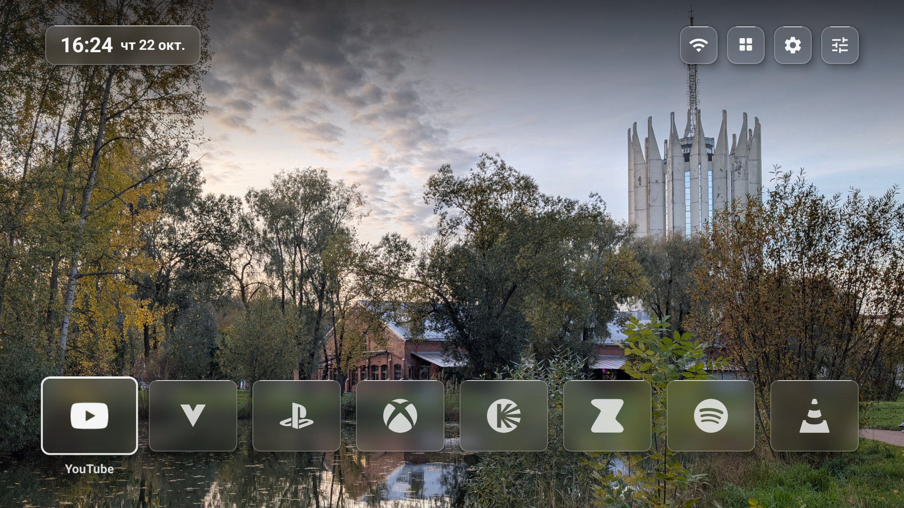
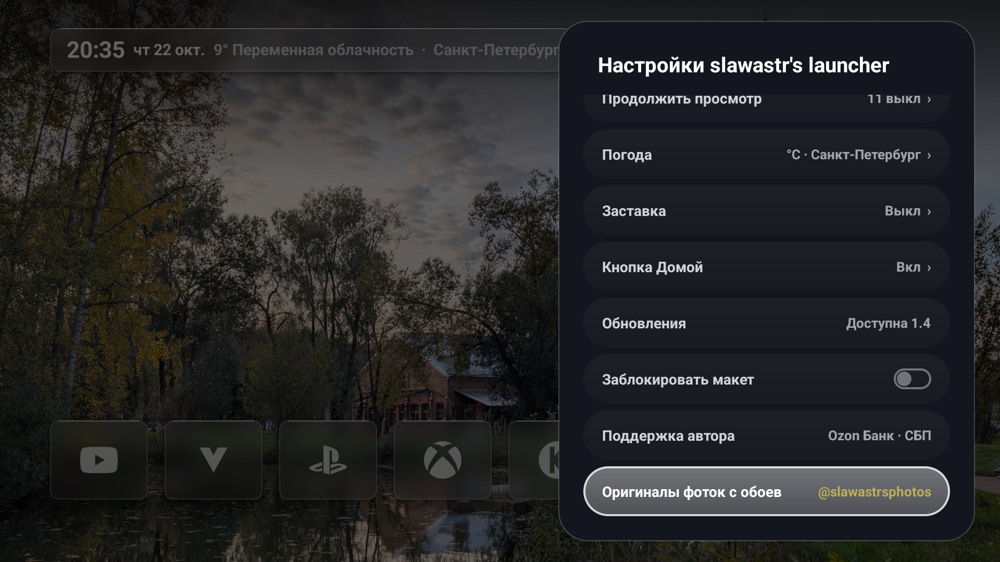
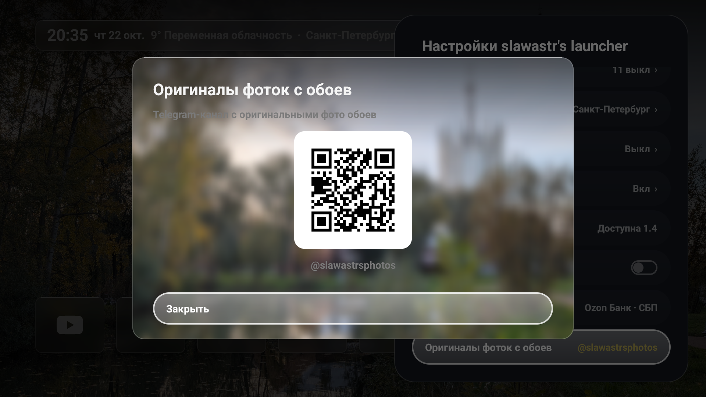

<h1 align="center">slawastr's launcher</h1>

<p align="center">
  <em>Минималистичный, сверхбыстрый и стильный домашний экран для Android TV и Google TV.</em>
</p>

<p align="center">
  
  
  
  
  <a href="LICENSE"></a>
</p>

---

<p align="center">
  
</p>

## 📸 Галерея интерфейса v1.1

<p align="center">
  
  
</p>

---

## 💎 Возможности и функционал

**slawastr's launcher** создан для тех, кто устал от перегруженных, медленных и заполненных рекламой стандартных интерфейсов современных телевизоров. Лаунчер возвращает устройству мгновенный отклик, чистоту и комфорт управления с пульта.

### 🔮 Эстетика Liquid Glass (Можно отключить)
- **Эффект матового стекла:** полупрозрачные плашки с настраиваемым радиусом размытия заднего плана и контурной подсветкой активных элементов.
- **Плавающая боковая карточка:** меню настроек выполнено в виде парящей панели 400dp с мягкими углами 28dp и эргономичными кнопками-пилюлями.
- **Контрастная подложка экрана «Все приложения»:** глубокое затемнение фона позади сетки установленных программ обеспечивает превосходную читаемость названий и иконок на любых дисплеях (OLED, MiniLED, QLED).

### ⚡ Быстродействие и отсутствие мусора
- **Экстремальная легковесность:** размер приложения всего 1.3 МБ, оперативная память ~50 МБ.
- **Нулевая телеметрия:** полное отсутствие рекламы, спонсорских рекомендаций, трекеров и аналитики.
- **Native Android Views:** приложение собрано на чистых системных компонентах Android без тяжеловесных сторонних библиотек и фреймворков. Холодный запуск занимает менее 100 мс.

### 🎮 Поддержка игровых консолей и видеовходов
- Автоматическое обнаружение подключённых приставок (**PlayStation**, **Xbox**, **Nintendo Switch**) и портов **HDMI 1–4**.
- Отображение нативных логотипов прямо в основной строке приложений и быстрое переключение источника в один клик.

### 🖼️ Продвинутая работа с обоями
- **Встроенная коллекция:** поддержка предустановленных динамических тем для светлого и тёмного режимов.
- **Локальные папки и USB-накопители:** показ фотографий из памяти ТВ или подключённых флешек с автоматической периодической сменой.
- **Загрузка по Wi-Fi с телефона:** сканируйте QR-код камерой смартфона и мгновенно отправляйте любые фото на телевизор без проводов и сторонних сервисов.
- **Точная подгонка:** ручное вертикальное кадрирование обоев для идеального расположения композиции на экране 16:9.

### 🎨 Кастомизация и удобство
- **Стилизация иконок:** полноцветный оригинальный вид или единый монохром с возможностью выбора любого оттенка через палитру HSV или HEX-код.
- **Управление типографикой:** выбор начертания системного шрифта (Light, Medium, Bold, Condensed, Serif, Mono).
- **Полка «Продолжить просмотр»:** бесшовная интеграция с поддерживаемыми онлайн-кинотеатрами прямо на главном экране.
- **Защита PIN-кодом:** блокировка настроек и изменения порядка иконок 4-значным PIN-кодом от детей или случайных нажатий.
- **Служба перехвата кнопки Домой:** встроенный сервис для гарантированного возврата на лаунчер при нажатии кнопки Home на любых телевизорах (включая Google TV).

---

## 📥 Установка на телевизор

### Вариант 1. Установка через ADB по сети (рекомендуется)
1. Скачайте актуальный файл `slawastr_launcher.apk` из раздела [**Releases**](https://github.com/SLAWASTR/slawastr-launcher/releases).
2. Подключитесь к телевизору и установите APK:
   ```bash
   adb connect <IP_ТЕЛЕВИЗОРА>:5555
   adb install -r slawastr_launcher.apk
   ```
3. Назначьте лаунчер основным домашним экраном:
   ```bash
   adb shell cmd role add-role-holder --user 0 android.app.role.HOME dev.plume
   ```
4. *(Опционально)* Отключите стандартный тяжелый рабочий стол Google TV:
   ```bash
   adb shell pm disable-user --user 0 com.google.android.apps.tv.launcherx
   adb shell pm disable-user --user 0 com.google.android.tungsten.setupwraith
   ```

### Вариант 2. Установка через флешку
Скопируйте `slawastr_launcher.apk` на USB-накопитель, откройте любой файловый менеджер на ТВ и подтвердите установку.

---

## 🧹 Очистка телевизора от системного мусора (Debloat)

Большинство телевизоров на базе Google TV / Android TV перегружены десятками фоновых сервисов трекинга, рекламы и тяжелых процессов.

> [!TIP]
> **Рекомендуется выполнять очистку с помощью ИИ в режиме парного программирования.**  
> ИИ проанализирует конкретную версию вашей прошивки, проверит зависимости системных компонентов (чтобы сохранить работу пульта ДУ и HDMI-CEC) и аккуратно заморозит лишнее безопасным флагом `disable-user`.
>
> 📖 Пошаговое руководство со списком безопасных служб: [**docs/DEBLOAT_GUIDE.md**](docs/DEBLOAT_GUIDE.md).

---

## 🛠️ Сборка из исходного кода

Для сборки проекта требуется JDK 17+ и установленный Android SDK (Platform 34–36, Build-Tools 34.0.0+).

```bash
# Клонирование репозитория
git clone https://github.com/SLAWASTR/slawastr-launcher.git
cd slawastr-launcher

# Сборка установочного пакета
./gradlew assembleDebug
```
Собранный APK-файл появится в директории: `app/build/outputs/apk/debug/app-debug.apk`.

---

## 🤖 Системный промпт для ИИ

Если вы планируете развивать лаунчер или добавлять новые функции с помощью языковых моделей, готовый архитектурный контекст и правила кодовой базы находятся в файле:  
👉 [**docs/AI_PROMPT.md**](docs/AI_PROMPT.md)

---

## 💬 Обратная связь и материалы

- 💬 **Предложения, идеи и ошибки:** Telegram [**@slawastr**](https://t.me/slawastr)
- 📷 **Оригиналы фото обоев в полном разрешении:** Telegram-канал [**@slawastrsphotos**](https://t.me/slawastrsphotos)
- 👤 **Автор проекта:** **slawastr**

---

## 📄 Лицензия

Распространяется под свободной лицензией [GPL-3.0 License](LICENSE).
